<div align="center">




<a href="https://portofolio-tamaguchi-nawfal-arfa.vercel.app"></a>


</div>


## 🪐 Tentang Saya

Saya seorang **Cybersecurity Enthusiast & Python Developer** yang suka membangun skrip otomatisasi dan bereksperimen dengan keamanan siber. Percaya bahwa belajar itu seperti menjelajah luar angkasa: pelan-pelan, tapi terus maju ke arah yang belum pernah dijajahi.

```yaml
astronaut:   Mohammad Nawfal Arfa
base:        Kota Gorontalo, Indonesia 🇮🇩
studi:       Linguistik Indonesia @ UPN "Veteran" Jawa Timur
misi:        [Cyber Security, Python Scripting, AI Lokal]
mempelajari: Network Security & Penetration Testing
side-quest:  Video editing 🎬
status:      🟢 online, menjelajah galaksi kode
```


## 🚀 Mission Log

| | Proyek | Keterangan |
| :---: | --- | --- |
| 🐱 | [**Portofolio Tamaguchi**](https://github.com/Izzatiin/Portofolio-Tamaguchi) | Portofolio dengan virtual pet 3D yang bisa dimainkan · [live](https://portofolio-tamaguchi-nawfal-arfa.vercel.app) |
| 🛡️ | [**Voidguard Engine**](https://github.com/Izzatiin/Voidguard-engine) | Engine keamanan siber |
| 🔭 | [**Void Recon**](https://github.com/Izzatiin/void-recon) | Alat reconnaissance |
| 🔐 | [**API Security Scanner**](https://github.com/Izzatiin/api_security_scanner) | Pemindai keamanan API |
| 📡 | [**Network Port Scanner**](https://github.com/Izzatiin/python-network-port-scanner) | Pemindai port jaringan dengan Python |
| 🧬 | [**File Integrity Monitor**](https://github.com/Izzatiin/Python-file-integrity-monitor) | Pemantau perubahan file dengan Python |
| 🤖 | [**AI Assistant Bot**](https://github.com/Izzatiin/AI-ASSISTANT-BOT) | Bot asisten AI |
| 🌙 | [**PyClock Sky**](https://github.com/Izzatiin/pyclock-sky) | Jam bertema langit dengan Python |


## 🛠️ Tech Stack

<div align="center">


</div>

## 🔐 Security Tools

<div align="center">


</div>


## 🌌 GitHub Stats

<div align="center">




</div>

## 📡 Kontak

<div align="center">

<a href="https://instagram.com/izzatiin_" target="_blank"></a>
<a href="https://linkedin.com/in/nawfal-arfa-496b3930b" target="_blank"></a>
<a href="mailto:nawfalarfa4@gmail.com" target="_blank"></a>
<a href="https://portofolio-tamaguchi-nawfal-arfa.vercel.app" target="_blank"></a>

</div>

<br>


